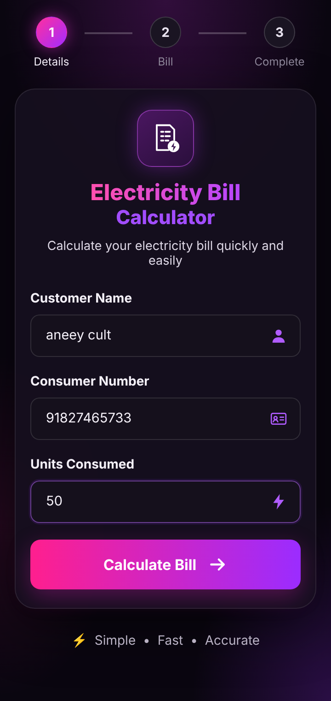
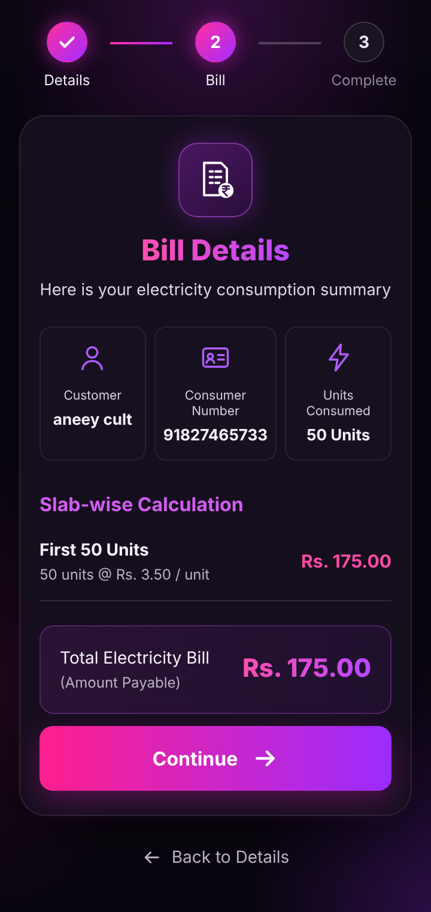
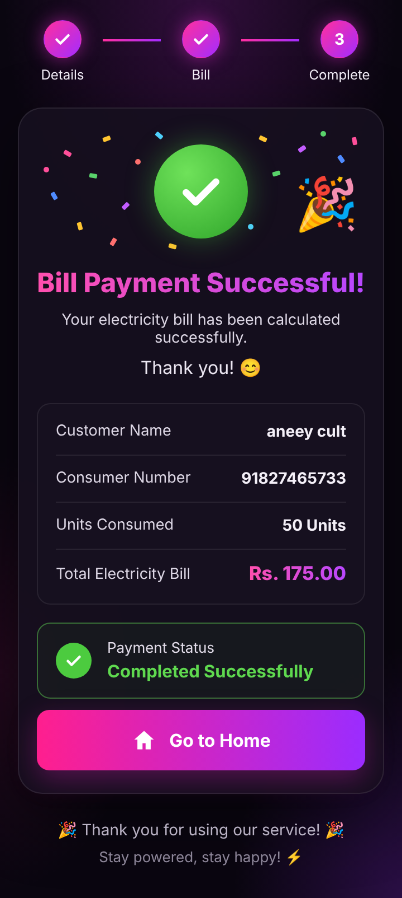
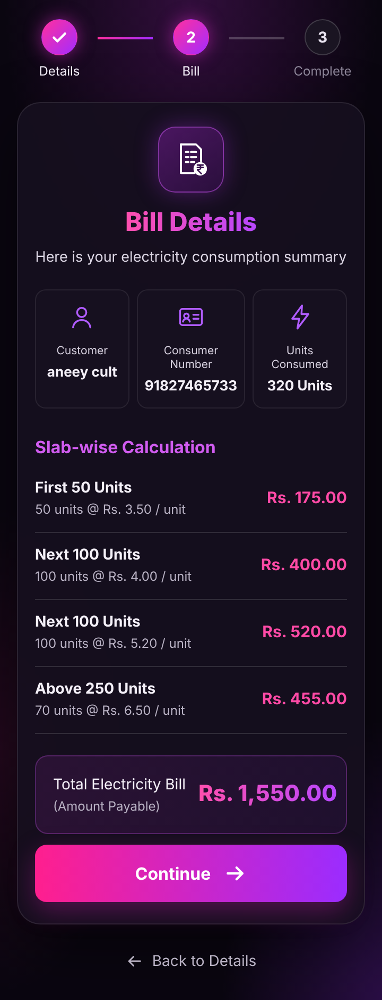
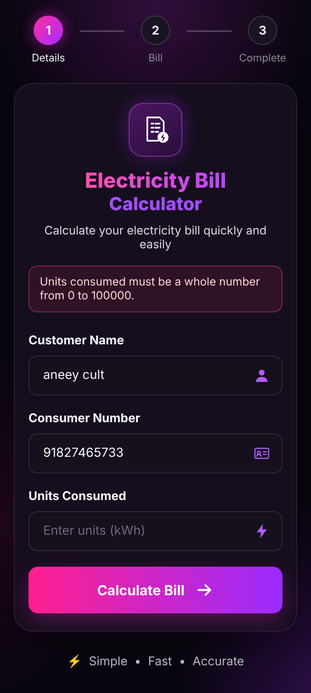
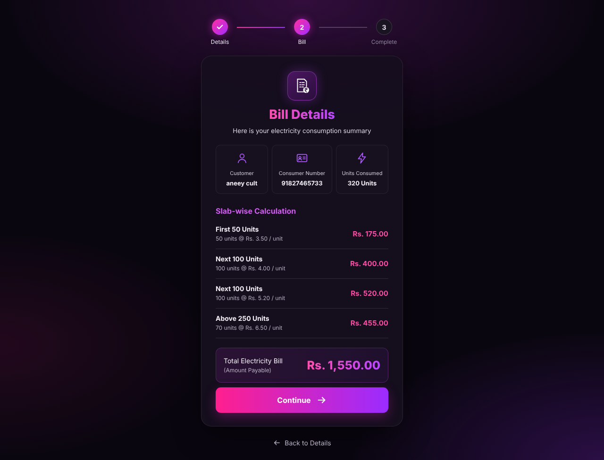

# ⚡ Electricity Bill Calculator Using JSP

A responsive web application, built with **JSP (JavaServer Pages)**, that calculates an electricity bill from the number of units consumed using a slab-wise tariff. It walks the user through three steps: **Details → Bill → Complete**.

<p align="center">
  
  
  
</p>

## Problem Statement

Design and develop a responsive website to calculate an electricity bill using JSP, with the following conditions:

| Units consumed | Rate |
|---|---|
| First 50 units | Rs. 3.50 / unit |
| Next 100 units (51–150) | Rs. 4.00 / unit |
| Next 100 units (151–250) | Rs. 5.20 / unit |
| Above 250 units | Rs. 6.50 / unit |

## Features

- **3-step flow** with a progress tracker: enter details, view the bill, see the confirmation
- **Slab-wise breakdown** showing how many units fall in each slab and what each slab costs
- **Server-side calculation** in JSP using `if-else` conditions; the final page recalculates the bill rather than trusting browser data
- **Input validation** on both sides: HTML5 checks in the browser and JSP checks on the server, with friendly error messages
- **Safe output:** all user input is HTML-escaped before display
- **Responsive design** in a dark theme with a pink/purple gradient that works on phones, tablets and desktops

## Code Concept

The program takes the number of units consumed and uses **if-else conditions** to find the matching slab, applies the rate for each slab, and displays the total bill.

```java
double calculateBill(int units) {
    double bill;
    if (units <= 50)
        bill = units * 3.50;
    else if (units <= 150)
        bill = 50 * 3.50 + (units - 50) * 4.00;
    else if (units <= 250)
        bill = 50 * 3.50 + 100 * 4.00 + (units - 150) * 5.20;
    else
        bill = 50 * 3.50 + 100 * 4.00 + 100 * 5.20 + (units - 250) * 6.50;
    return bill;
}
```

**Example:** 320 units = 50 × 3.50 + 100 × 4.00 + 100 × 5.20 + 70 × 6.50 = **Rs. 1,550.00**

## Project Structure

```
Electricity-Bill-Calculator-Using-JSP/
├── pom.xml                          # Maven build (packages a WAR)
├── screenshots/
└── src/main/webapp/
    ├── index.jsp                    # Step 1: customer details form
    ├── bill.jsp                     # Step 2: validation + slab-wise bill
    ├── success.jsp                  # Step 3: payment successful
    ├── css/style.css                # Responsive styling
    └── WEB-INF/
        ├── web.xml                  # Deployment descriptor
        └── jspf/
            ├── billing.jspf         # Tariff, calculation and helper methods
            └── steps.jspf           # Step progress tracker
```

## How to Run

**Requirements:** JDK 11+ and Apache Tomcat 9, 10 or 11.

**Option 1: copy into Tomcat (quickest)**
1. Copy the `src/main/webapp` folder into Tomcat's `webapps` folder and rename it `ElectricityBillCalculator`.
2. Start Tomcat (`bin/startup.bat` on Windows, `bin/startup.sh` on Linux/macOS).
3. Open **http://localhost:8080/ElectricityBillCalculator/**

**Option 2: build a WAR with Maven**
```bash
mvn clean package
```
Copy `target/ElectricityBillCalculator.war` into Tomcat's `webapps` folder and open the same URL.

**Option 3: Eclipse / NetBeans / IntelliJ**
Import it as a Maven project, add a Tomcat server, and choose *Run on Server*.

## Screenshots

| All four slabs (320 units) | Validation | Desktop |
|---|---|---|
|  |  |  |

## Technologies Used

JSP · Java · HTML5 · CSS3 · Apache Tomcat · Maven

## Conclusion

The Electricity Bill Calculator was designed and developed using JSP. It calculates the bill from the units consumed and the given slab rates, with a simple, user-friendly interface for entering customer details and viewing the result. The project covers JSP, HTML forms, server-side processing, conditional statements and deployment on Apache Tomcat. Possible future enhancements include a database, authentication, online payments and bill history.
